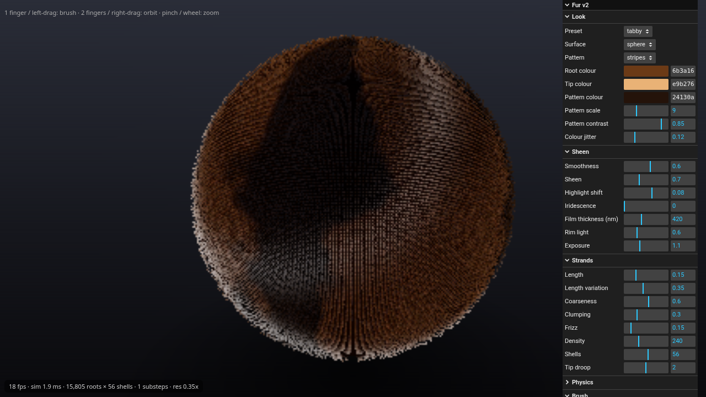

# Fur Shader Playground



A tactile, real-time **fur material playground** for the web. Shell-textured strands, anisotropic sheen, thin-film iridescence and spring physics you can comb with a finger, mouse or pen. Every look parameter is editable live.

## Tech stack
TypeScript · Vite · three.js (WebGL2, custom GLSL3 `ShaderMaterial`) · lil-gui · Playwright + axe-core · ESLint (typescript-eslint) · GitHub Actions

## What's inside
- **Shading:** instanced shell texturing (one draw call). Kajiya-Kay diffuse with Marschner-style dual specular lobes (R and TRT made by tangent shift), a thin-film iridescence term, rim light, depth AO, tip taper, clumping, frizz and per-strand length and colour jitter. ACES tone mapping.
- **Physics:** a damped spring per root using semi-implicit Euler. Substeps are chosen automatically (Δt·√k ≤ 0.5). Offsets are clamped by surface collision and a 1.2× stretch limit, and NaN or out-of-range inputs are rejected.
- **Interaction:** one pointer combs or pushes the fur and the comb relaxes back over time. Two fingers or a right-drag orbit; pinch or the wheel zooms. `touch-action: none`, and there is a mobile layout.
- **Surfaces:** sphere, plane, torus and torus knot.

## Live controls (lil-gui, all ranges are bounded)
| Group | Controls |
|---|---|
| Look | preset, surface, pattern (solid/stripes/spots/gradient/marble), root/tip/pattern colour, pattern scale, contrast, colour jitter |
| Sheen | smoothness, sheen, highlight shift, iridescence, film thickness (nm), rim, exposure |
| Strands | length, length variation, coarseness, clumping, frizz, density, shells, tip droop |
| Physics | stiffness, damping, gravity, wind, wind direction, turbulence |
| Brush | comb/push, strength, radius, recovery |
| Actions | randomize, save preset (localStorage), copy and paste JSON, smooth out comb, reset |

Presets: tabby, snow leopard, neon, velvet moss, iridescent, shaggy.

## Why WebGL2 (and not WebGPU yet)
WebGL2 runs on every current browser, iOS Safari included, and three's `ShaderMaterial` keeps the shader readable. The next step would be a WebGPU/TSL version with GPU compute for the strand physics.

## QA Achievements
These checks passed in `npm test` (6/6, about 1.4 min). The runs used **headless Chromium with SwiftShader software GL** in low-quality test mode (`?q=low`: 12 shells, 0.5 DPR, no MSAA). The fps figures are **software-GL numbers, not GPU numbers**.
- ✅ Typecheck, ESLint and production build are clean.
- ✅ Loads with **0 console errors and 0 WebGL errors**.
- ✅ **All 6 presets and 3 more surfaces render** a non-blank frame. Luminance variance ranged from 396 to 4,283, against a threshold of 20.
- ✅ **Stress at the control extremes:** max length, min stiffness and 96 shells, plus out-of-range and NaN inputs. Result: **no NaN**, and max offset stayed at 1.20× strand length, inside the 2.1× bound. Simulation step took about 2.3 ms for 15,805 roots.
- ✅ **Mouse drag combs the fur:** comb displacement went from 0 to 0.90 of strand length.
- ✅ **Mobile 390×844 touch** (real CDP touch events): one finger combs (0.90), a two-finger pinch zooms (radius 3.6 → 8.0), the page doesn't scroll, there is no horizontal overflow, and the panel starts collapsed.
- ✅ **Accessibility:** axe-core WCAG 2 A/AA on the control panel found **0 violations** (13 rules passed). Every control has an accessible name and the panel is reachable by keyboard.
- ℹ️ Software-GL frame rate: about 17.6 fps at load and 15.3 fps after the stress test. Real-GPU performance hasn't been measured.

## Run it
```bash
npm install
npm run dev        # http://localhost:5173  (add ?q=low for weak devices)
npm test           # build + Playwright suite (needs: npx playwright install chromium)
npm run lint
```
Screenshots from the suite are written to `shots/`. `v1/` holds the original single-file prototype for comparison.

## License
MIT
